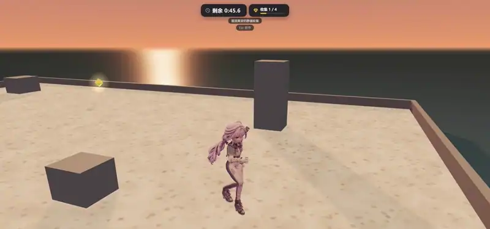
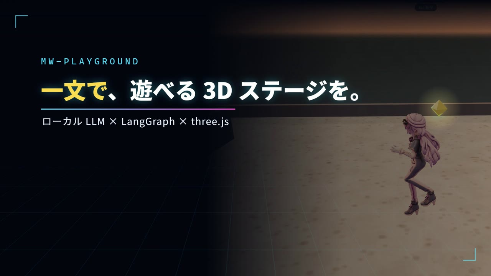
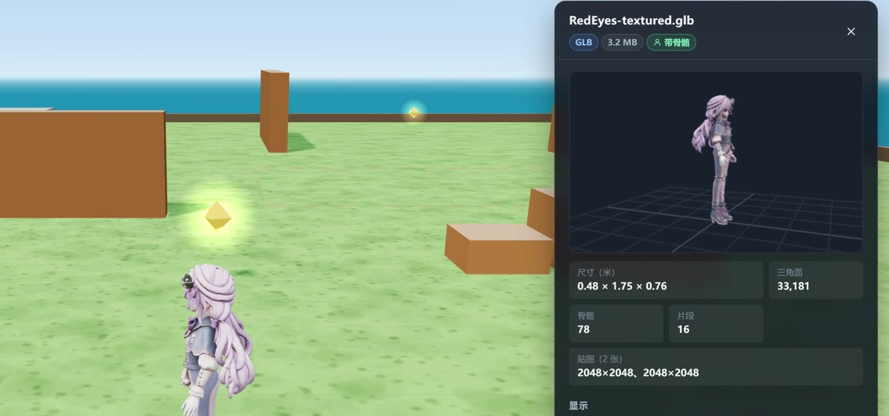
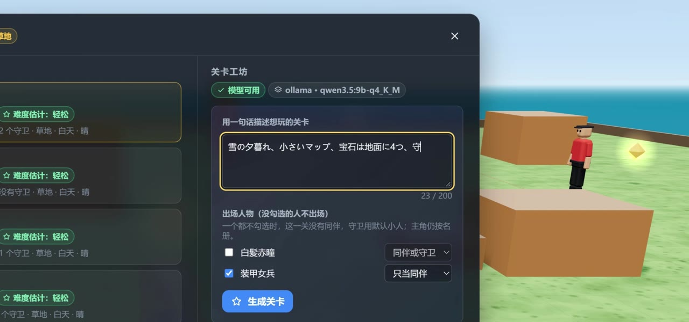
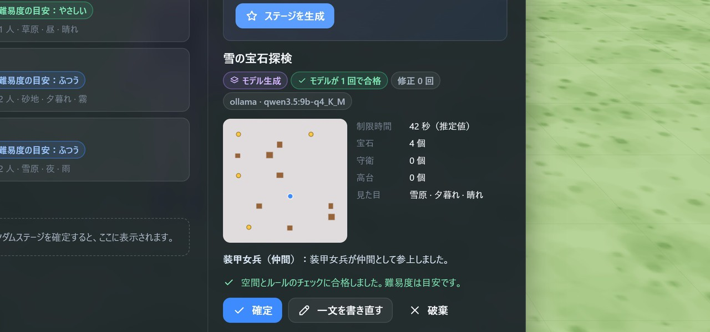
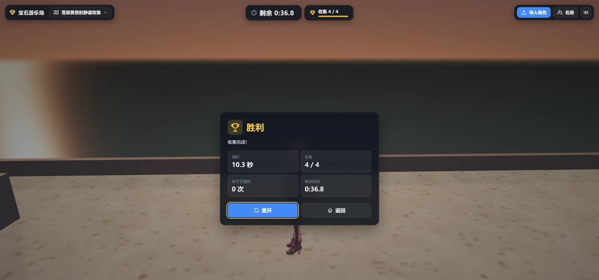
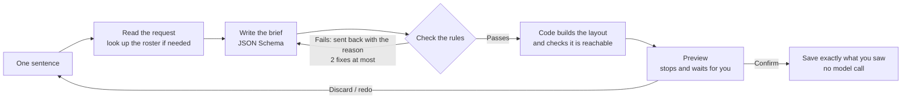

<h3 align="center">
  <a href="README.md">日本語</a> &nbsp;|&nbsp; <a href="README.zh.md">简体中文</a> &nbsp;|&nbsp; English
</h3>

<p align="center">
  
</p>

<h1 align="center">mw-playground</h1>

<p align="center"><b>Write one sentence, get a 3D level you can play.</b></p>

<p align="center">
  <a href="https://youtu.be/nlM76iN8KgE">Demo video</a> ·
  <a href="docs/how-it-works.en.md">How the Level Workshop works</a> ·
  <a href="docs/guide.en.md">Playing and settings</a>
</p>

I also make [Modelwright](https://github.com/chenyihang98-pixel/Modelwright), a tool that turns a single image into a 3D character that can run and jump. The characters had nowhere to go once they were made, so I built this small browser game. Drop in a GLB exported from Modelwright and it becomes the player character, a companion or a guard. You collect gems before the timer runs out and stay away from the guards on patrol.

I didn't want to lay out every level by hand either, so there is a Level Workshop. Write something like "Snowy dusk, small map, four gems on the ground, no guards, and have the armored soldier follow me", and a local LLM turns it into a level brief. Code builds the layout and checks it, and nothing is saved until you have seen the preview and confirmed it.

Everything runs on your own machine. The game is three.js, the workshop service is LangGraph, and the model is qwen3.5 9B through Ollama.

## Demo

[](https://youtu.be/nlM76iN8KgE)

A one-minute intro video with Japanese captions: import a character, write a sentence, look at the preview, confirm, play the level.

| | |
|---|---|
|  |  |
| Import a character made in Modelwright and play as it | Write one sentence in the Level Workshop |
|  |  |
| Preview first. Nothing is saved until you confirm | All gems collected |

<sub>The interface can be switched between English, Japanese and Chinese. The screenshots and the video above show the Chinese one.</sub>

## What it does

- **Character import**: GLB with a skeleton and animations, plus static OBJ / STL / PLY models. Idle, walk and run are picked from the clip names, and you can fix them by hand. Missing motions get a stand-in (no run clip: the walk clip is played faster)
- **Roster**: imported characters are stored in the browser and survive a reload. Each one can be the player character, a companion or a guard. Companions follow diagonally behind you
- **Levels**: three hand-made maps, three generated ones that are frozen, plus "random level" and the Level Workshop
- **Level Workshop**: one sentence in, a level out. You choose who may appear and whether they can be a companion or a guard
- **Save and replay**: confirmed levels stay in the browser, and replaying them needs no model
- **Works without a model**: if Ollama isn't running, the workshop says why and offers a random level. The rest of the game is unaffected
- **Three languages**: the interface comes in English, Japanese and Chinese. Switch on the start screen or in the pause menu

## How the Level Workshop works



- The model has one job: turn a sentence into the options of a brief (map size, number of gems, number of guards, weather, who appears). It never writes a coordinate
- Code builds the layout from a seed, and separate code checks it: every gem can be reached on foot, patrol routes don't cross walls, the spawn point isn't too close to a guard
- When the brief breaks a rule (two guards on a small map, say), the model is told which field and why, and gets up to two fixes. If that still fails, the game falls back to a built-in level and tells you why
- The preview step pauses on a LangGraph interrupt. Confirming doesn't call the model again. What gets saved is the layout you were looking at

More in [How the Level Workshop works](docs/how-it-works.en.md).

## How it went

I ran 8 generations with a local qwen3.5 9B.

- For 7 of them I wrote down beforehand what the result had to satisfy (for example "three platforms, gems only on the platforms, six in total"). All 7 did
- In all 8, the saved layout was the same one shown in the preview
- With the model already loaded, request to preview took 2.2 to 3.7 seconds

The eighth was a deliberately awkward request: "small map, two guards". A small map allows one guard, so the brief was sent back, and the model changed the map to medium to get through the checks. It passed, but the small map I asked for was gone. That's why I count "passed the checks" and "did what was asked" separately.

One machine, one model, a handful of runs, so don't read this as a success rate. Each request and its result is in [docs/evidence/workshop-20261116](docs/evidence/workshop-20261116/) (in Chinese).

## Running it

You need Node.js 24 and [Ollama](https://ollama.com). I use Windows 11 with a 16 GB GPU.

```sh
npm ci
ollama pull qwen3.5:9b-q4_K_M
npm run dev:workshop
```

Open http://127.0.0.1:5173 in a browser. Click Import character and pick a GLB, then open Levels. The Level Workshop is on the right.

You can play without a character file (the default player is a blocky figure). To try the game without the model, `npm run dev` is enough.

Keys, import limits and the settings you can change are in [Playing and settings](docs/guide.en.md).

## Known issues

- Text written by the model (level title, opening, lines) doesn't follow the interface language yet. It comes out in Chinese
- The workshop is meant to run locally and handles one request at a time
- An unconfirmed preview lives in the service's memory, so restarting the service loses it and you have to generate again. Confirmed levels are not affected
- To get past the rules, the model sometimes changes something you asked for explicitly (the "small map" case above). The preview shows how many fixes it took, so look before you save
- The time limit is estimated from the route. It may not be enough for everyone
- There is code for OpenAI-compatible APIs, but I have only tried it against a fake server, never a real provider
- Only run on Windows 11 and Chromium

## What's in the repo

| Folder | Contents |
|---|---|
| `src/game/` | The game: simulation, level generation and checking, rendering, UI |
| `src/import/`, `src/roster/` | Character import and the roster |
| `src/workshop/` | The browser half of the Level Workshop |
| `server/` | The local workshop service: the LangGraph graph, prompts, Ollama and OpenAI-compatible providers |
| `src/asset/` | GLB structure inspection (`npm run inspect-asset`) and generated test models |
| `tests/` | Unit tests and Playwright end-to-end tests |
| `docs/` | The two pages linked above, plus development notes (in Chinese) |

Test models are generated by code on the spot. There are no model files in the repo.

## How it was built

Most of the code was written by Claude Code and reviewed by Codex, which sends it back when it doesn't pass. My part is the spec decisions (for example "characters you didn't tick in the workshop don't appear"), choosing the review model for each task, and signing off before each push. What each task built and how many review rounds it took is in [docs/status.md](docs/status.md) (in Chinese).

## License

MIT. See [LICENSE](LICENSE).
