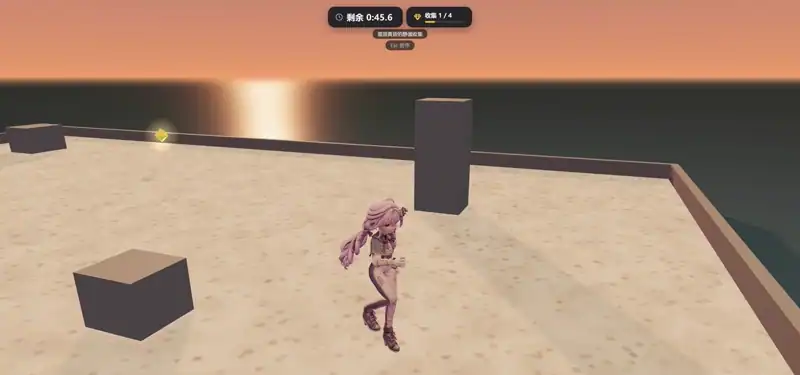
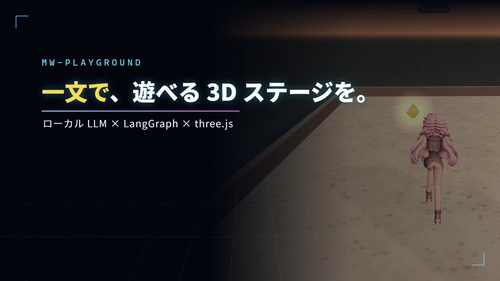
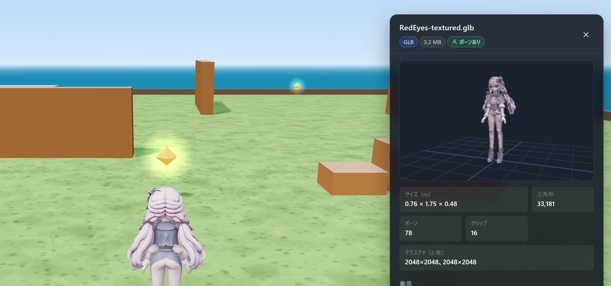
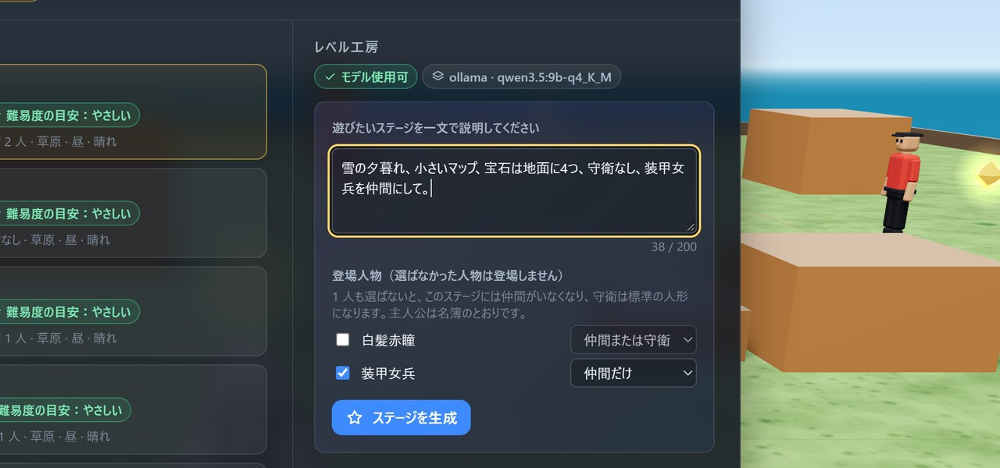
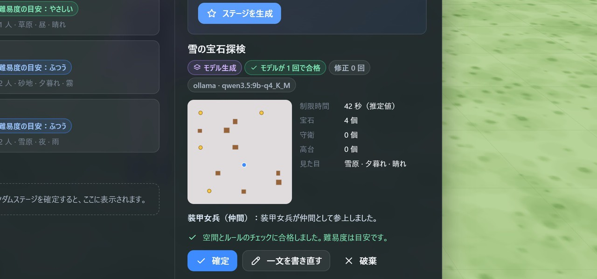
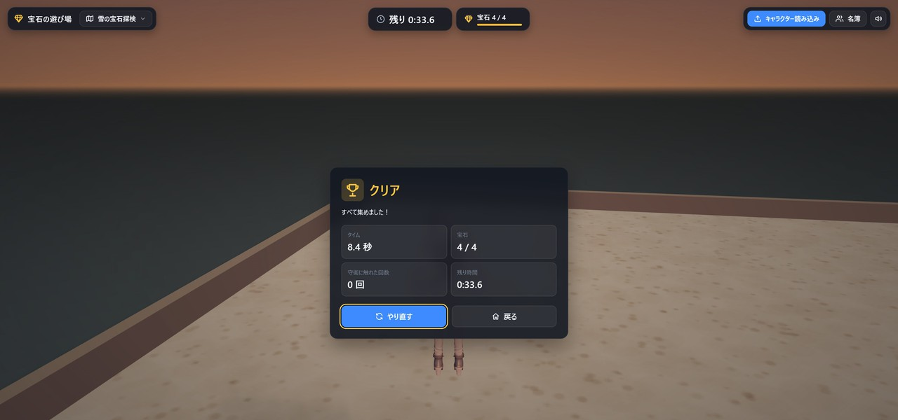
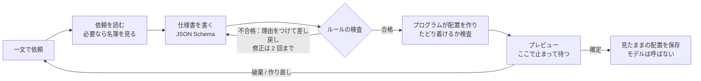

<h3 align="center">
  日本語 &nbsp;|&nbsp; <a href="README.zh.md">简体中文</a> &nbsp;|&nbsp; <a href="README.en.md">English</a>
</h3>

<p align="center">
  
</p>

<h1 align="center">mw-playground</h1>

<p align="center"><b>一文で、遊べる 3D ステージを。</b></p>

<p align="center">
  <a href="https://youtu.be/4zSBDaET-JA">デモ動画</a> ·
  <a href="docs/how-it-works.md">レベル工房のしくみ</a> ·
  <a href="docs/guide.md">遊び方と設定</a>
</p>

画像 1 枚から、走って跳べる 3D キャラクターを作るツール [Modelwright](https://github.com/chenyihang98-pixel/Modelwright) を別に作っています。ただ、できたキャラクターを使う場所がありませんでした。そこで、ブラウザーで遊べる小さなゲームを作りました。Modelwright から書き出した GLB を読み込めば、主人公にも、仲間にも、守衛にもなります。制限時間内に宝石を集めて、巡回する守衛を避けるゲームです。

ステージを 1 つずつ手で組むのも面倒だったので、「レベル工房」を付けました。「雪の夕暮れ、小さいマップ、宝石は地面に 4 つ、守衛なし、装甲女兵を仲間にして」のように一文を書くと、ローカルの LLM がそれをステージ仕様書に直します。配置を作って検査するのはプログラムで、プレビューを見て確定したものだけが保存されます。

すべて自分の PC の中で動きます。ゲームは three.js、工房のサービスは LangGraph、モデルは Ollama の qwen3.5 9B です。

## デモ

[](https://youtu.be/4zSBDaET-JA)

1 分ほどの紹介動画です。キャラクターの読み込み、一文での依頼、プレビュー、確定、プレイまでを通しています。

| | |
|---|---|
|  |  |
| Modelwright で作ったキャラクターを読み込んで、そのまま主人公に | レベル工房に一文を書く |
|  |  |
| まずプレビュー。確定するまで保存されません | 宝石を全部集めてクリア |

<sub>画面は日本語・英語・中国語に切り替えられます。上のスクリーンショットと動画は日本語の画面です。</sub>

## できること

- **キャラクターの読み込み**：GLB（ボーンとアニメーション付き）のほか、OBJ / STL / PLY の静的モデルも読めます。待機・歩き・走りなどはクリップ名から自動で割り当て、違っていれば手で直せます。足りないモーションは代わりで補います（走りがなければ歩きを速めて使う、など）
- **名簿**：読み込んだキャラクターはブラウザーに保存され、再読み込みしても残ります。それぞれを主人公・仲間・守衛にでき、仲間は主人公の斜め後ろをついてきます
- **ステージ**：手作りのマップが 3 つ、生成して固定したものが 3 つ。ほかに「ランダムで 1 つ」とレベル工房があります
- **レベル工房**：一文からステージを作ります。誰を登場させるか、仲間にするか守衛にするかも選べます
- **保存してもう一度遊ぶ**：確定したステージはブラウザーに残り、遊び直すのにモデルは要りません
- **モデルがなくても遊べる**：Ollama が動いていないときは工房が理由を表示し、「ランダムで 1 つ」で代わりにステージを作れます。ゲームのほかの部分はそのまま動きます
- **3 つの言語**：画面は日本語・英語・中国語。スタート画面と一時停止メニューで切り替えられます

## レベル工房のしくみ



- モデルの仕事は 1 つだけ。一文を、仕様書の選択肢（マップの大きさ、宝石の数、守衛の数、天気、登場人物）に置き換えることです。座標は 1 つも書かせません
- 配置はシードからプログラムが作り、別のプログラムが検査します。宝石すべてに歩いて届くか、巡回ルートが壁を抜けていないか、スタート地点が守衛に近すぎないか
- 仕様書がルールに合わないとき（小さいマップに守衛 2 人、など）は、どの項目がなぜ駄目かをモデルに返して直させます。修正は 2 回まで。それでも駄目なら内蔵ステージに切り替えて、理由を表示します
- プレビューでは LangGraph の interrupt で処理を止めています。確定を押してもモデルはもう呼ばず、見ていた配置がそのまま保存されます

詳しくは [レベル工房のしくみ](docs/how-it-works.md) に書きました。

## 試した結果

ローカルの qwen3.5 9B で 8 回生成してみました。

- うち 7 回は、「これだけは満たすこと」を先に決めておいた依頼です（たとえば「高台 3 つ、宝石は高台の上だけに、全部で 6 個」）。7 回とも満たしていました
- 8 回とも、プレビューと保存された配置は同じものでした
- モデルが読み込み済みなら、依頼からプレビューまで 2.2〜3.7 秒です

残りの 1 回は、わざと無理な注文にしました。「小さいマップ、守衛 2 人」。小さいマップの守衛は 1 人までなので差し戻され、モデルはマップを中サイズに変えて検査を通しました。検査は通っても、「小さいマップ」は守られていません。なので「検査に通った」と「頼んだとおりになった」は分けて数えています。

PC 1 台、モデル 1 つ、回数も少ないので、成功率として読めるものではありません。依頼と結果は 1 回ずつ [docs/evidence/workshop-20261116](docs/evidence/workshop-20261116/) に置いてあります（中国語）。

## 動かす

Node.js 24 と [Ollama](https://ollama.com) が必要です。自分の環境は Windows 11、VRAM 16 GB の GPU です。

```sh
npm ci
ollama pull qwen3.5:9b-q4_K_M
npm run dev:workshop
```

ブラウザーで http://127.0.0.1:5173 を開きます。「キャラクター読み込み」で GLB を選び、「ステージ選択」を開くと、右側がレベル工房です。

キャラクターのファイルがなくても遊べます（最初の主人公は四角い人形です）。モデルを使わずにゲームだけ試すなら、`npm run dev` で足ります。

キー操作、読み込みの上限、変えられる設定は [遊び方と設定](docs/guide.md) にまとめました。

## 既知の問題

- モデルが書く文（ステージのタイトル、冒頭の文、セリフ）は、画面の言語で書くように頼んでいるだけで、言語のチェックはしていません。手元の 9B モデルで試したときはどれもその言語で返ってきましたが、名簿の名前を書き換えることがありました（「ハナ」が「花」に）。保存済みのステージの文は、作ったときの言語のままです
- 工房はローカルで動かす前提で、一度に扱える依頼は 1 件です
- 確定前のプレビューはサービスのメモリーにあるので、サービスを再起動すると消えます。作り直してください。確定済みのステージには影響しません
- モデルがルールを通すために、はっきり頼んだ条件を変えてしまうことがあります（上の「小さいマップ」の例）。プレビューに修正回数が出るので、保存前に見てください
- 制限時間はルートから見積もった値です。誰でも間に合うとは限りません
- OpenAI 互換 API にもつなげるように書いてありますが、偽サーバーで試しただけで、実際のサービスにはつないでいません
- 動かしたのは Windows 11 と Chromium だけです

## 中身

| フォルダ | 中身 |
|---|---|
| `src/game/` | ゲーム本体。シミュレーション、ステージの生成と検査、描画、画面 |
| `src/import/`、`src/roster/` | キャラクターの読み込みと名簿 |
| `src/workshop/` | レベル工房のブラウザー側 |
| `server/` | レベル工房のローカルサービス。LangGraph のグラフ、プロンプト、Ollama と OpenAI 互換 API への接続 |
| `src/asset/` | GLB の構造チェック（`npm run inspect-asset`）と、テスト用モデルの生成 |
| `tests/` | ユニットテストと Playwright の E2E テスト |
| `docs/` | 上の 2 つの説明と、開発中のメモ（中国語） |

テスト用のモデルはコードがその場で作るので、リポジトリにモデルファイルは入っていません。

## 作り方について

コードは主に Claude Code が書き、Codex がレビューして、通らなければ差し戻す、という流れで作りました。自分がやっているのは、仕様の判断（たとえば「工房で選ばなかった人物は登場させない」）、タスクごとのレビュー用モデルの選択、プッシュ前の確認です。タスクごとに何を作り、レビューが何周したかは [docs/status.md](docs/status.md) に残しています（中国語）。

## ライセンス

MIT ライセンスです（[LICENSE](LICENSE)）。
