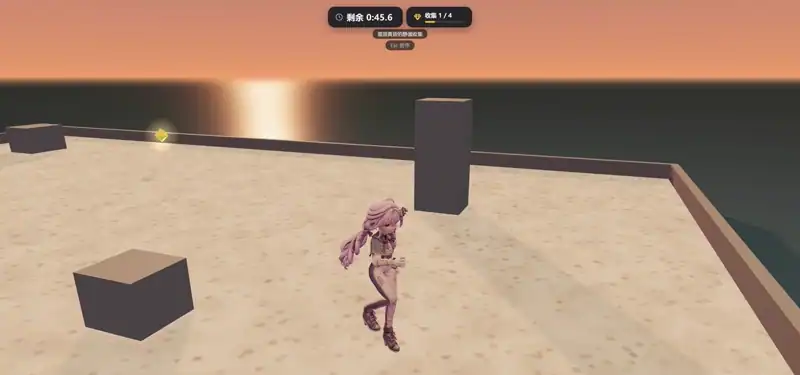
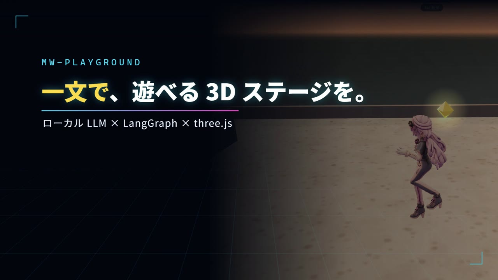
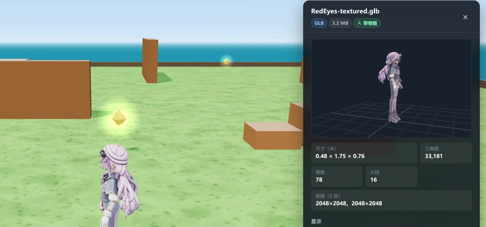
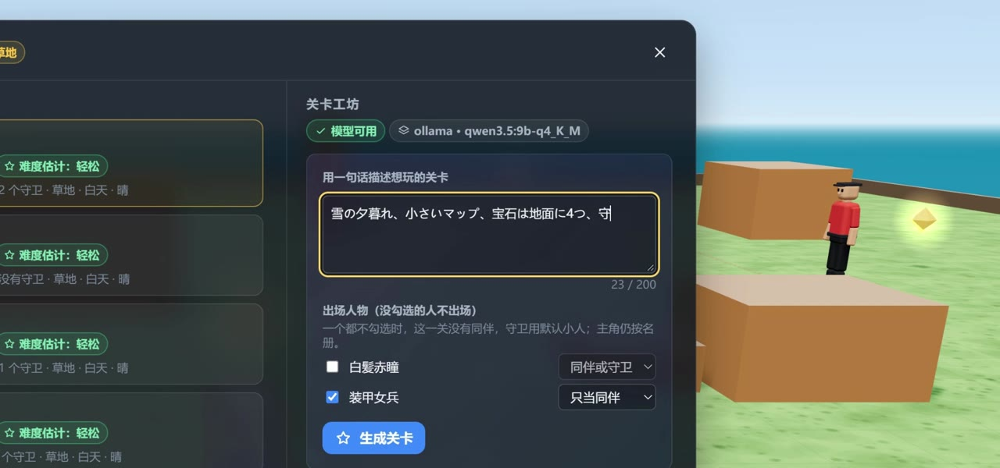
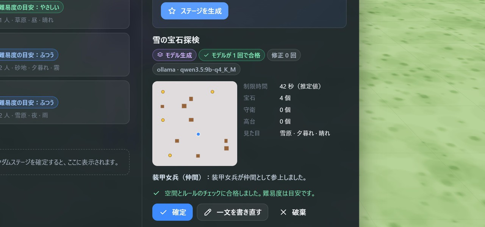
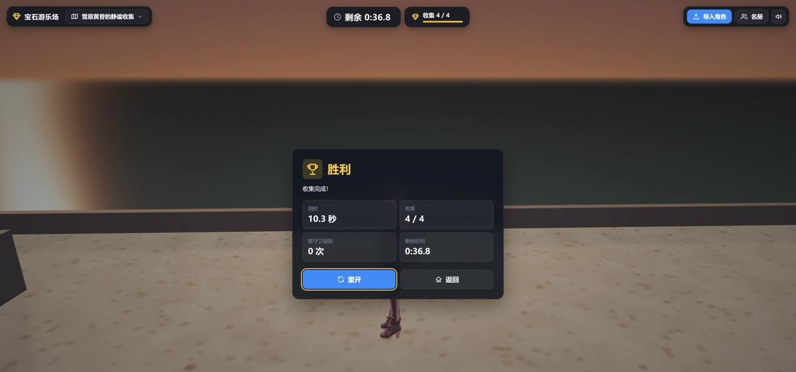
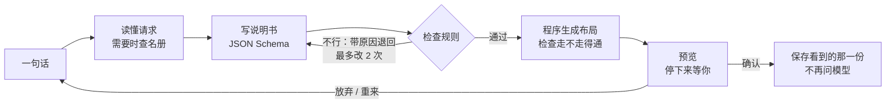

<h3 align="center">
  <a href="README.md">日本語</a> &nbsp;|&nbsp; 简体中文 &nbsp;|&nbsp; <a href="README.en.md">English</a>
</h3>

<p align="center">
  
</p>

<h1 align="center">mw-playground</h1>

<p align="center"><b>写一句话，生成一关能玩的 3D 关卡。</b></p>

<p align="center">
  <a href="https://youtu.be/nlM76iN8KgE">演示视频</a> ·
  <a href="docs/how-it-works.zh.md">关卡工坊怎么做的</a> ·
  <a href="docs/guide.zh.md">玩法和设置</a>
</p>

我另外做了个工具叫[模匠](https://github.com/chenyihang98-pixel/Modelwright)，能把一张图变成会跑会跳的 3D 角色。可角色做出来以后没地方用，于是做了这个浏览器小游戏：把模匠导出的 GLB 拖进来，就能当主角、同伴或者守卫，在限时内收集宝石、躲开巡逻的守卫。

关卡也不想一关一关手摆，所以加了关卡工坊。写一句“雪地的黄昏，小地图，四颗宝石放在地面上，没有守卫，让装甲女兵跟着我”，本机的大模型把它填成一份关卡说明书；布局由程序生成和检查，看过预览、点了确认才保存。

全部在自己电脑上跑：游戏用 three.js 写，工坊的服务用 LangGraph，模型是 Ollama 里的 qwen3.5 9B。

## 演示

[](https://youtu.be/nlM76iN8KgE)

一分钟左右的介绍视频（日语字幕）：导入角色、写一句话、看预览、确认、玩完一关。

| | |
|---|---|
|  |  |
| 把模匠做的角色拖进来，直接当主角 | 在关卡工坊里写一句话 |
|  |  |
| 先看预览，确认了才保存 | 宝石收齐，过关 |

<sub>界面可以切换中文、日语、英语。上面的截图和视频里是中文界面。</sub>

## 能做什么

- **导入角色**：GLB（带骨骼和动画），还有 OBJ / STL / PLY 的静态模型。待机、走、跑这些动作按片段名字自动认，认错了可以手动改；缺动作时有替代（比如没有跑就用走加快）
- **名册**：导入的人物存在浏览器里，刷新还在。每个人可以当主角、同伴或守卫，同伴会跟在主角斜后方
- **关卡**：三张手工地图，三关生成好固定下来的，再加“随机一关”和关卡工坊
- **关卡工坊**：一句话生成关卡，可以勾选让谁出场、当同伴还是守卫
- **保存和重玩**：确认过的关卡存在浏览器里，重玩不需要模型
- **没有模型也能玩**：Ollama 没开时工坊会说明原因，可以用“随机一关”顶上，游戏其他部分不受影响
- **三种语言**：界面有中文、日语、英语，在开始界面和暂停菜单里切换

## 关卡工坊怎么做的



- 模型只做一件事：把一句话变成说明书里的选项（地图多大、几颗宝石、几个守卫、什么天气、谁出场）。坐标它一个都不写
- 布局由程序按种子生成，再由另一段程序检查：每颗宝石都走得到，巡逻路线不穿墙，出生点离守卫够远
- 说明书不合规则时（比如小地图放了两个守卫），把哪一项、为什么不行告诉模型让它改，最多改两次；还不行就换成内置关卡，并说明原因
- 预览那一步用 LangGraph 的 interrupt 停住。点确认时不再问模型，保存的就是你看到的那一份

细节写在[关卡工坊怎么做的](docs/how-it-works.zh.md)。

## 试下来的结果

用本机的 qwen3.5 9B 试了 8 次生成：

- 其中 7 次是事先写好“必须满足哪几项”的请求（比如“三个高台，宝石只放在高台上，一共六颗”），7 次都满足了
- 8 次的预览和最后保存的布局都是同一份
- 模型已经在显存里时，从发出请求到看到预览要 2.2 到 3.7 秒

剩下的 1 次是故意出的难题：“小地图，两个守卫”。小地图最多一个守卫，模型被退回后把地图改成了中等，检查过了，但“小地图”没保住。所以“检查通过”和“满足了要求”我是分开记的。

只在一台电脑、一个模型上试过，次数也少，不能当成成功率。每次的请求和结果放在 [docs/evidence/workshop-20261116](docs/evidence/workshop-20261116/)。

## 跑起来

需要 Node.js 24 和 [Ollama](https://ollama.com)。我用的是 Windows 11 和一块 16 GB 显存的显卡。

```sh
npm ci
ollama pull qwen3.5:9b-q4_K_M
npm run dev:workshop
```

浏览器打开 http://127.0.0.1:5173 。点“导入角色”选一个 GLB，再点“选关”，右边就是关卡工坊。

没有角色文件也能玩，默认主角是个方块小人。只想玩游戏、不用模型的话，`npm run dev` 就够了。

按键、导入的上限、能改的设置都在[玩法和设置](docs/guide.zh.md)。

## 已知问题

- 模型写的文字（关卡标题、开场白、台词）还没跟着界面语言走，现在都是中文
- 工坊只在本机跑，一次只处理一个请求
- 没确认的预览放在服务的内存里，服务重启就没了，要重新生成；确认过的关卡不受影响
- 模型有时会为了通过规则，改掉你明说的条件（上面“小地图”那个例子）。预览里写着它改了几次，保存前看一眼
- 时间限制是按路线估出来的，不保证每个人都来得及
- OpenAI 兼容接口写了，但只用假服务试过，没接过真的服务商
- 只在 Windows 11 和 Chromium 上跑过

## 仓库里有什么

| 目录 | 内容 |
|---|---|
| `src/game/` | 游戏本体：模拟、关卡的生成和检查、渲染、界面 |
| `src/import/`、`src/roster/` | 角色导入和名册 |
| `src/workshop/` | 关卡工坊在浏览器里的那一半 |
| `server/` | 关卡工坊的本机服务：LangGraph 流程、提示词、Ollama 和 OpenAI 兼容接口 |
| `src/asset/` | GLB 结构检查（`npm run inspect-asset`）和测试用模型的生成 |
| `tests/` | 单元测试和 Playwright 端到端测试 |
| `docs/` | 上面两篇说明，加上开发时的笔记 |

测试用的模型都是代码现场生成的，仓库里没有模型文件。

## 怎么做出来的

代码主要是 Claude Code 写的，Codex 来审，审不过就退回去改。我管的是规则怎么定（比如“工坊里没勾选的人不出场”）、每个任务用哪个模型来审，还有每次推送前的确认。每个任务做了什么、审了几轮，都记在 [docs/status.md](docs/status.md)。

## 许可

MIT 许可，见 [LICENSE](LICENSE)。
